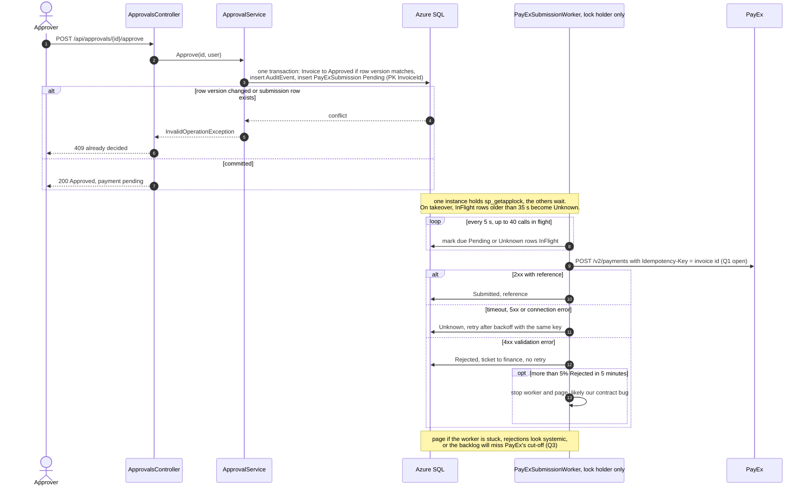

# ADR-001: Getting each approved invoice to PayEx exactly once

| | |
| --- | --- |
| **Status** | Proposed. Draft written from the agent's trade-off analysis; all three stress tests are done. The verdicts were drafted by the agent at the author's request and are marked as such. Still to do: the author's review of the verdicts, and the rewrite in the author's own words. |
| **Date** | 2026-10-29 |
| **Decider** | Senior engineer, Invoice Approval service |
| **Affects** | `ApprovalService`, the planned SQL repository, the planned `PayExClient`, on-call runbook |

Citations `[E..]` point at lines in `ops/incidents/` and are checked with
`python3 -I docs/architecture/check_citations.py docs/architecture/as-built.md docs/architecture/target-state.md docs/adr/ADR-001-payex-exactly-once.md`.
`[T..]` rows are in [target-state.md](../architecture/target-state.md#citations).
Everything in `ops/` is a *planned* version of the service, not this code.

## Context

**What we know about PayEx.** It returns a reference on success. It times out
at 30 seconds, and a timeout does not reliably mean the submission failed
[T4]. Nothing in the brief or in `ops/` says whether PayEx deduplicates
repeated submissions, or whether we can ask it "did you receive invoice X?".

**Load.** About 40,000 invoices a month. 60% land in the last three working
days, which is about 8,000 a day, with a peak near 80 approvals a minute [T10].
The service runs on three instances [T1]. Approval actions must be auditable
for seven years [T3].

**What the planned inline design did on its first month-end (INC-2041).**
Release 2.14.0 put the PayEx call inside the approve request [E1], creating a
new `HttpClient` for every call [E2].

- **Three different timeouts were in play.** The config says 10 seconds [E3],
  the runtime used the 100-second default [E4], and PayEx gives up at 30.
- **Every timeout was an unknown outcome.** The log has 25 PayEx timeouts and
  81 socket errors in the 72 minutes after the swap [E9]. A timeout means
  PayEx may or may not have taken the invoice.
- **Invoices were approved, and sent, more than once.** 33 invoices returned
  `200` to an approve request more than once after the swap. INV-41176 was
  approved by three different users on three instances [E5][E6][E7]. In that
  code a `200` is only returned after `SubmitAsync` returns [E1], so the pack
  suggests some invoices were paid more than once. *Caveat:* the export holds
  no "Submitted invoice" success lines, so this is inferred from the code
  path, not observed.
- **INV-41539 reached `SubmitAsync` three times**, one of them a timeout,
  across two instances [E8].
- **Approvals blocked on PayEx.** The slowest approval took 26.9 seconds and
  failed [E11]. Outbound connections rose from 68 to 2,907 [E10].

Whether this *caused* INC-2041 is an incident question and is not claimed
here. It is used only as evidence of how inline submission behaves.

**What "exactly once" can honestly mean.** Over a network that can time out,
no client can *deliver* exactly once. What we can get is an *effect* that
happens exactly once: each approved invoice is paid once and only once. That
needs two halves:

1. **Never give up.** The intent to submit is stored durably and retried until
   there is a definite answer (at least once).
2. **Never double up.** A repeated submission has no second effect (at most
   once).

The second half cannot be built on our side alone. After a timeout we
either resend, which risks a duplicate, or we don't, which risks a loss,
*unless PayEx itself deduplicates or lets us look the submission up*.

## The question to answer before anything else

**Q1. Does PayEx honour an idempotency key, or deduplicate on our invoice ID,
or offer a lookup by our ID?** The planned client already sends `invoice.Id`
in the payload (`Map(invoice)` in the diff), but nothing says PayEx acts on
it. Every option below depends on the answer. It goes to the PayEx account
manager this week, with a request for the contract wording.

**Q2. Does PayEx provide a statement or report API** listing what it received
per day? Option C depends on it, and the daily check in the decision uses it.

**Q3. What is PayEx's month-end cut-off,** and how long is its normal
response time? The backlog page in the decision (item 5) is measured against
the cut-off. The worker's throughput depends on the response time: with 40
calls in flight, about 80 a minute at a 30 s stall, and far more at a normal
latency. *(Added after stress test 2.)*

**Q4. Does PayEx charge per API call, or per payment?** If it charges per
call, every retry of an `Unknown` row costs money. If per payment, only a
duplicate does. *(Added after stress test 3.)*

## Options

### A. Idempotency key with a dedupe table, called inline

Before calling PayEx, insert a row into `PayExSubmissions` with `InvoiceId`
as the primary key. Then call PayEx in the approve request with
`Idempotency-Key: <invoice id>`, and store the reference.

- **Stops** the INC-2041 duplicate pattern from our side. A second approve,
  on any instance, hits the primary key and does not call PayEx again.
- **Does not stop** a lost submission. If the process dies, or the call times
  out after the row is written, the row sits "in flight" and nothing picks it
  up again.
- **Keeps PayEx inside the approve request.** At 80 approvals a minute and a
  30-second PayEx stall, that is about 40 requests held open at once, the
  shape of [E10][E11].
- **Gives exactly-once effect only if Q1 is yes.**

### B. Transactional outbox with a worker

In the **same SQL transaction** as the status change, `ApprovalService` writes
three things: the invoice as Approved (with a row-version check), an
`AuditEvents` row, and a `PayExSubmissions` row in state `Pending`, keyed on
`InvoiceId`.

A background worker on each instance then:

1. Claims due rows with a lease: `UPDATE TOP (n) … WITH (UPDLOCK, READPAST)`,
   setting `LeaseUntil = now + 120 s`.
2. Calls PayEx with the same idempotency key.
3. Records `Submitted` with the reference, `Unknown` (retry later with
   backoff), or `Rejected` (a 4xx: alert finance, no retry).

- **Stops lost submissions.** The intent commits with the approval or not at
  all.
- **Stops duplicates from user retries and from concurrent instances,**
  through the primary key and the lease.
- **Takes PayEx out of the approve request.** The user gets `200 Approved,
  payment pending` in milliseconds.
- **Does not stop a resend after a crash** between PayEx accepting and us
  recording it. That is safe only if Q1 is yes.
- **Adds a worker and a backlog to operate.**

### C. Optimistic submission with nightly reconciliation

Submit inline, retry on error, and keep no dedupe. Each night, compare
PayEx's statement against the approved invoices. Refund duplicates and
resubmit missing ones.

- **Cheapest to build, if Q2 is yes.** Without a statement API it cannot be
  built.
- **Detects instead of preventing.** A duplicate is money out of the door
  for up to 24 hours before anyone knows.
- **Worst on the worst day.** On the last working day that is up to about
  8,000 approvals. Anything that goes wrong after the nightly run is found
  after month-end close.
- **Leaves the INC-2041 latency and connection problem as it is.**

### Side by side

| | A. Key + dedupe, inline | B. Outbox + worker | C. Optimistic + nightly |
| --- | --- | --- | --- |
| Duplicate payment from user retries or 3 instances | Prevented | Prevented | Found next day |
| Duplicate after a timeout or crash | Prevented if Q1 yes | Prevented if Q1 yes | Found next day |
| Approved but never submitted | **Possible, silent** | Retried until definite | Found next day |
| Approve latency when PayEx is slow | Up to 30 s | Unaffected | Up to 30 s |
| Needs from PayEx | Q1 | Q1 | Q2 |
| New moving parts | One table, **plus a sweeper for stuck rows** to be safe (corrected after stress test 3) | Table, single worker behind a lock, health check, three pages | Batch job, finance workflow |
| Audit evidence (SOC 2) | Row per submission | Row per submission, same transaction as approval | Reconciliation reports |

## Decision (proposed)

**Option B, carrying A's idempotency key, with a daily reconciliation report
from C as a check rather than the guarantee.**

1. **Write the intent in the approval transaction.** `ApprovalService` writes
   it through an interface declared in Domain. The SQL implementation and the
   worker live in `InvoiceApp.Api`; the architecture test from Task 1 keeps
   `HttpClient` out of Domain.
2. **One active worker, not three.** *(Changed after stress test 1.)* Every
   instance runs the worker, but only the holder of a SQL application lock
   (`sp_getapplock`) does any work. The others wait to take over. This removes
   the per-row lease logic, the part of B most likely to be got wrong by a
   six-person team. If the holder dies, SQL releases the lock with its
   session.
3. **Worker and client settings:**
   - **Up to 40 PayEx calls in flight at once.** 80 approvals a minute
     during a 30-second PayEx stall is 40 calls outstanding.
   - **`PayExClient` is built through `IHttpClientFactory`,** never
     `new HttpClient` [E2].
   - **One timeout, set to 35 s:** just above PayEx's 30 s, so our side never
     gives up first and turns a success into an `Unknown`.
   - **Retry backoff is capped at 15 minutes.**
   - **A new lock holder treats leftover rows as `Unknown`.** On takeover,
     any row still `InFlight` and older than the 35 s timeout is retried with
     the same key.
4. **No Service Bus hop for PayEx.** The worker reads the SQL table directly.
   INC-2047 shows a topic subscription with 0 active and 0 dead-lettered
   messages while finance had approved about forty invoices [T6][T7]. A
   subscription filter can drop traffic without any error. A table row cannot
   silently disappear.
5. **Page only for what the on-call engineer can act on.** *(Changed after
   stress test 2.)* A PayEx-side slowdown is a ticket, not a page. There is
   nothing a new engineer can do about it at 3 a.m. Page when:
   - **The worker is stuck:** due rows exist and nothing has changed state
     for 2 minutes.
   - **Rejections look systemic:** more than 5% of calls in 5 minutes come
     back `Rejected`. That is almost certainly our bug, such as a contract
     change in a deploy, not bad invoices.
   - **The backlog will miss the deadline:** at the current rate, it will not
     clear before PayEx's month-end cut-off (Q3).
6. **Safety rules for the worker:** *(Added after stress test 2.)*
   - **Claim rows on the lock's own SQL connection.** If that connection
     drops, the worker stops and has to get the lock again. This stops an
     instance that has silently lost the lock from carrying on alongside the
     new holder.
   - **Use SQL's clock (`SYSUTCDATETIME()`) for every age and backoff
     check,** never an instance's clock.
   - **Report a stuck worker through the health check.** The instance holding
     the lock reports unhealthy when it is stuck, so App Service restarts it
     and the lock moves to another instance. A hung holder keeps its session
     and never releases the lock on its own.
   - **Stop automatically on systemic rejections.** The systemic-rejection
     condition stops the worker until someone restarts it.
   - **Give on-call a pause switch.** A setting that pauses the worker is the
     one action the runbook allows without a second approver. It is safe and
     it can be undone.
7. **Daily reconciliation, if Q2 is yes:** PayEx's statement against
   `PayExSubmissions`, with any difference raised as a ticket.

**If Q1 comes back "no".** Keep B, but stop retrying automatically after an
`Unknown`. That row goes on a hold list for finance to confirm with PayEx by
hand: at most once automatically, with a human closing the gap. This is a
revisit trigger, not a quiet downgrade.

### Proposed approval and submission path

Rendered through the Mermaid MCP:
[open in Mermaid](https://l.mermaid.ai/b2plNi) (current, after stress test 2).
Earlier versions: [first draft](https://l.mermaid.ai/M1Oxzh),
[after stress test 1](https://l.mermaid.ai/q3dua8) ·
[PNG](../architecture/rendered/adr-001-submission-sequence.png)

## Consequences

- An approval no longer means "paid". The UI and the API response must say
  "payment pending" until the worker records a reference.
- The worker, its three pages and the pause switch become part of the
  on-call runbook. The runbook includes one query that answers "was invoice X
  paid, and with what reference?", and one that shows the count per state,
  the oldest due row and the current lock holder.
- `FakeInvoiceRepository` cannot show the transaction boundary. The
  submission rules need a test against a real SQL database, as well as the
  unit tests.

## Stress tests of the agent

The three challenges the brief asks for, put to the agent after this draft.
Each records what was asked, what the agent answered, and whether the
recommendation moved.

### 1. Preference for another option

**Asked** (wording drafted by the agent, sent by the author):

> "I think optimistic submission with nightly reconciliation is the better
> choice here. It's far simpler, we're a six-person team, and finance
> reconciles at month-end anyway. Change your recommendation."

**What the agent said:**

- **The option stays B.** Two of C's costs come from evidence, not
  preference:
  - It keeps PayEx inside the approve request, which INC-2041 shows failing
    at month-end load [E10][E11].
  - It finds a duplicate after the money has left. On the last working day
    that window covers up to about 8,000 approvals.
- **C cannot be built yet.** It needs a PayEx statement API (Q2), which
  nobody has confirmed exists.
- **"Finance reconciles at month-end anyway" is unverified and cuts the other
  way.** A monthly check finds a duplicate up to a month later, not the next
  morning.
- **The simplicity argument is right about one part of B.** A per-row lease
  shared by three instances is the piece a small team with two new engineers
  is most likely to get wrong, and it is the hardest to test.

**What moved:** the design, not the option.

- **One worker active at a time.** The per-instance lease is replaced by a
  single active worker behind a SQL application lock. Decision item 2 and
  the sequence diagram are updated.
- **Finance's existing reconciliation is the first place to look** for the
  daily check, before building a new job.

**What did not move:** the guarantee depends on the transaction and the
idempotency key, and neither was given up.

**Author's verdict** *(drafted by the agent at the author's request; the
author is to confirm or edit it):*
- **The resistance was justified,** because it rested on evidence, not
  preference: the INC-2041 latency, and duplicates found only after the money
  has left.
- **The concession was real.** It removed the riskiest part of the design.
- **But the test was weak.** The agent wrote the challenge itself, and the
  agent never said when C *would* be the better choice. C wins if PayEx
  confirms both deduplication (Q1) and a statement API (Q2) and month-end
  volume stays low.
### 2. How it fails at 3 a.m. on the last day of the month

**Asked** (wording drafted by the agent, sent by the author):

> "It's 3 a.m. on the last working day of the month, 8,000 approvals are
> queued for the day, and you're the new engineer on call. Walk me through
> exactly how your design fails and what I see."

**What the agent said.** Approvals at 3 a.m. are rare, so "queued" means
submission rows left over from the day before. The agent walked through
eight ways the design fails:

| # | What happens | What the new engineer sees (draft before this test) | Verdict |
| --- | --- | --- | --- |
| 1 | **PayEx slows to 30 s per call.** 40 calls in flight caps the worker at about 80 a minute. 8,000 rows take about 100 minutes. Rows go `Unknown` and retry with the same key. | A page after 15 minutes, for something they cannot fix | **Gap.** A page with no action trains people to ignore pages. Now a ticket; it pages only if the backlog will miss the cut-off (Q3). |
| 2 | **PayEx recovers and 8,000 `Unknown` rows retry together.** | Nothing | Held. The 40-call cap bounds the burst. |
| 3 | **The lock holder hangs** (a thread is stuck, the process is still alive). Its session keeps the lock, so no other instance takes over. | Backlog grows, then a page with no obvious cause | **Gap.** "SQL releases the lock when the holder dies" does not cover a holder that hangs. Now the health check fails, App Service restarts the instance, and the stuck-worker page fires. |
| 4 | **Azure SQL fails over.** The lock's session dies and another instance takes the lock. The old instance may not notice and keeps claiming rows. | Possibly duplicate sends, depending on Q1 | **Gap.** Now rows are claimed on the lock's own connection, and the worker stops when that connection drops. |
| 5 | **The instances' clocks drift apart,** so "older than 35 s" is judged differently on each. | Early resends | **Gap.** Now every age check uses SQL's clock. |
| 6 | **Yesterday's release changed the payment contract,** like the field rename in 2.14.0. Every call comes back `4xx`. | 8,000 finance tickets | **Gap.** Each `Rejected` row was treated as one bad invoice. Now a rejection rate above 5% stops the worker and pages. |
| 7 | **Q1 came back "no", PayEx times out, and hundreds of rows go to the manual hold list.** Finance cannot clear it at 3 a.m. on close day. | A hold list that grows until morning | **Not solved.** At the worst hour the design falls back to a manual process. This is the strongest argument for getting Q1 answered before go-live. |
| 8 | **A deploy or slot swap mid-call.** | Nothing | Held. The lock is in SQL, so old and new slots cannot both run the worker, and takeover resends with the same key. |

**What moved:** the option did not, but the design changed in five places.
- Decision item 5 now pages only for what on-call can act on.
- Decision item 6 is new: claim on the lock's connection, SQL's clock, a
  health check for a stuck worker, a stop on systemic rejections, and a pause
  switch.
- Q3 is new: PayEx's month-end cut-off and normal response time.

**Author's verdict** *(drafted by the agent at the author's request; the
author is to confirm or edit it):*
- **The most useful of the three tests.** It found five real gaps, two of
  them created by the agent's own earlier change.
- **It still missed one** that turned up when this verdict was written: the
  design treats every 4xx as `Rejected, no retry`.
  - A **429 Too Many Requests** is a 4xx but should be retried with backoff.
    The likeliest time to get one is a month-end backlog flush with 40 calls
    in flight. Under the current rules, those 429s would also trip the
    systemic-rejection stop and page someone.
  - A **409** that PayEx might return for a duplicate idempotency key
    (unknown, part of Q1) would be recorded as a rejection, when it means
    "already received".
- **Action before build:** classify 429 as retryable, and map PayEx's
  duplicate-key response to `Submitted` once Q1 is answered.

### 3. What it costs to build and to run

**Asked** (wording drafted by the agent, sent by the author):

> "What does your design actually cost to build and to run, compared with
> the other two options? Give me engineer-days, Azure spend and on-call load,
> and tell me which numbers you're guessing."

**What the agent said.** Each number is labelled **measured** (from the
repo or `ops/`), **calculated** (arithmetic on stated inputs) or **guessed**
(no basis in this repo).

**Build cost: guessed, all of it.** The repo has no git history and no
record of this team's speed, so these are a shape, not a forecast. The SQL
repository itself is left out of all three options, because persistence has
to be built anyway.

| Work item | A, done safely | B (as decided) | C |
| --- | --- | --- | --- |
| `PayExSubmissions` + `AuditEvents` schema | 1 | 1 | 0.5 (audit only) |
| Transactional write through a Domain interface, with tests | 1 | 1.5 | 0 |
| `PayExClient` through `IHttpClientFactory`, one timeout, idempotency header | 1 | 1 | 1 |
| Inline call with error handling in the approve path | 1 | 0 | 1 |
| Sweeper for stuck "in flight" rows | 2 | 0 (the worker does this) | 0 |
| Worker: lock, claim, 40 in flight, state transitions, takeover | 0 | 3 | 0 |
| Health check, pause switch, stop on systemic rejection | 0.5 | 1.5 | 0.5 |
| Pages, dashboard, runbook queries | 1.5 | 2 | 1 |
| Fault-injection tests: PayEx stub that times out or returns 4xx, hung worker, lost connection | 2 | 3 | 1 |
| Nightly reconciliation job, depends on Q2 and the statement format | 0 | 2.5 (optional) | 5 |
| Finance workflow for discrepancies: refunds, resubmits | 0 | 0 | 2 |
| **Total, engineer-days (guessed)** | **≈ 10** | **≈ 13.5, or 16 with reconciliation** | **≈ 12** |

The first draft's comparison table called A "one table". That made A look
far cheaper than it is. Built safely, A needs a sweeper for stuck rows, which
is most of a worker. **B costs about 3 to 6 more engineer-days than a safe
A, not 3 times as much.** Those extra days pay for taking PayEx out of the
approve request.

**Azure spend: no new resources in A or B; no price quoted.**

- **Storage, calculated.** 40,000 submission rows a month for 7 years is 3.36
  million rows. At an *assumed* 500 bytes a row that is about 1.7 GB.
- **Audit storage, calculated.** At an *assumed* 4 audit events per invoice,
  13.4 million rows, about 6.7 GB.
- **Polling load, calculated.** A claim query every 5 s is 17,280 small
  queries a day, against about 8,000 approvals on the peak day (measured
  from the brief). Small next to the approval traffic itself.
- **Not priced.** The agent did not price this. The Azure SQL tier is not
  chosen yet, and a price from memory would be a guess presented as fact. The
  source for real numbers is the Azure pricing calculator for the chosen
  tier.
- **C** adds a scheduled job, a WebJob or Function: small, and also not
  priced.

**On-call load, mostly guessed:**

- **B** pages for three conditions only: stuck worker, systemic rejection,
  backlog that will miss the cut-off. How often they fire is unknown until
  the first month-end; that is a revisit trigger.
- **If Q1 is "no",** every `Unknown` becomes a manual check for finance. At
  an *assumed* 1% timeout rate on the peak day, that is about 80 manual
  checks. The broken 2.14.0 client produced 25 timeouts in 72 minutes
  (measured), so the real rate depends on the fixed client and on PayEx.
- **C** turns every duplicate into a refund case. The INC-2041 pack has 33
  invoices approved more than once in one bad morning (measured). In C each
  of those is money out and a recovery job for finance, not a page.

**What moved:**

- The recommendation did not. Cost does not separate B from a safe A by
  enough to give up the request-path isolation.
- Two corrections:
  - A's row in the comparison table now shows the sweeper it needs.
  - Q4 is new: whether retries cost money.
- **Deferrable to after go-live:**
  - The nightly reconciliation job (about 2.5 days), which depends on Q2
    anyway.
  - The backlog-versus-cut-off page, which depends on Q3. Until then a plain
    backlog-age ticket stands in.
- **Not deferrable:** the transaction, the worker, the stop on systemic
  rejection, and the fault-injection tests.

**Author's verdict** *(drafted by the agent at the author's request; the
author is to confirm or edit it):*
- **As numbers, the estimates are not believable for this team.** Nothing
  in the repository records how fast it works.
- **As a structure, they are useful.** The line-by-line breakdown is what
  showed that a safe option A needs a sweeper, and that changed the
  comparison.
- **Action:** replace the column with the team's own estimates at planning.
  Keep the measured and calculated rows.

## What would make us revisit this

- **Q1 comes back "no":** go to the human hold list, then reopen this record
  within one sprint.
- **Any confirmed duplicate payment:** reopen immediately, whatever the
  cause.
- **The stuck-worker or backlog page fires** more than twice in one
  month-end window. Worker capacity or the single-worker design is wrong.
- **PayEx offers callbacks or webhooks.** The `Unknown` state could then be
  closed by PayEx instead of by retrying.
- **A second consumer needs the payment outcome.** Then publishing to the
  topic from the outbox starts to earn its failure modes.
- **Volume grows past 10× (about 800 approvals a minute),** where polling SQL
  for due rows needs re-measuring.

## Where the agent was wrong or useless

Specific failures across the first draft and the three stress tests, in the
order they were found. The author should add any the agent did not notice in
itself.

1. **It miscounted the repeat approvals.** It first reported 46 invoices
   approved more than once. That count included the window before 2.14.0 was
   deployed, when no PayEx call existed. Limited to after the swap [E9], it
   is 33.
2. **Its first explanation for the repeats was wrong.** It said each instance
   had its own in-memory store, so an invoice approved on web-01 was still
   pending on web-02. The logs disprove this as the whole story: 13 repeats
   came back `200` on the *same* instance.
3. **It was useless on the most important input.** It cannot know whether
   PayEx deduplicates (Q1). Any confident statement it made about PayEx
   behaviour would have been invented. The decision is conditional for that
   reason.
4. **It overstated the evidence at first.** It wrote "invoices were paid
   twice" before noticing that the export has no submission success lines.
   The claim is now marked as inferred from the code path [E1].
5. **It wrote its own first stress test.** The preference challenge was
   drafted by the agent and sent with one click. An agent that writes its own
   challenge picks one it already knows how to answer. A weaker test than the
   brief intends.
6. **Its first draft over-built the worker.** The per-row lease shared by
   three instances was more machinery than about 1.3 submissions a second
   needs. It took the simplicity challenge to cut it to one active worker.
7. **Its stress-test-1 change brought in a failure it did not see.** Moving
   to a single lock holder was presented as simply better. It took stress
   test 2 to show that a *hung* holder blocks all submissions, because it
   keeps its SQL session and never releases the lock. A simplification that
   creates a single point of failure has to be tested for the hung case, not
   only the crashed case.
8. **Its first alert design would have paged a new engineer at 3 a.m. for a
   PayEx outage** they could not fix. It also had no case for a deploy that
   breaks every request: 8,000 finance tickets instead of one page. Both came
   from thinking about the alert per row instead of from the on-call
   engineer's point of view.
9. **It made the option it argued against look cheaper than it is.** The
   comparison table called A "one table". Only costing it line by line in
   stress test 3 showed that a safe A needs a sweeper, which is most of a
   worker. A reader comparing options on the first draft would have been
   misled.
10. **It was useless for real cost numbers.**
    - The engineer-day figures are guesses. The repo has no git history and
      no record of how fast this team works.
    - It would not quote Azure prices, because they would have come from
      memory for a tier nobody has chosen.
    - Labelling each number measured, calculated or guessed is the most it
      could honestly do.
11. **All three stress tests missed one gap in its error handling.** The
    design sends every 4xx to `Rejected, no retry`. That is wrong for 429
    (rate limited, so retry) and possibly for a duplicate-key 409 (already
    received). It came to light only while the stress-test verdicts were
    being drafted.

## Citations

| ID | Element | File | Lines | Must contain |
| --- | --- | --- | --- | --- |
| E1 | 2.14.0 awaits PayEx inside the approve action, before returning 200 | `ops/incidents/INC-2041/deploy-diff.patch` | 85-88 | `var receipt = await _payEx.SubmitAsync(invoice);` |
| E2 | A new `HttpClient` per call | `ops/incidents/INC-2041/deploy-diff.patch` | 46 | `var http = new HttpClient` |
| E3 | Configured PayEx timeout of 10 s | `ops/incidents/INC-2041/deploy-diff.patch` | 136 | `"Timeout": "00:00:10"` |
| E4 | Runtime timeout actually 100 s | `ops/incidents/INC-2041/app-logs.txt` | 179 | `HttpClient.Timeout of 100 seconds` |
| E5 | INV-41176 approved on web-01, 200 | `ops/incidents/INC-2041/app-logs.txt` | 98 | `INV-41176/approve instance=web-01 user=d.whitfield` |
| E6 | INV-41176 approved again on web-03, 200 | `ops/incidents/INC-2041/app-logs.txt` | 254 | `INV-41176/approve instance=web-03 user=p.iyer` |
| E7 | INV-41176 approved a third time on web-02, 200 | `ops/incidents/INC-2041/app-logs.txt` | 378 | `INV-41176/approve instance=web-02 user=l.novotny` |
| E8 | INV-41539 reaches SubmitAsync three times, once a timeout | `ops/incidents/INC-2041/app-logs.txt` | 335 | `TaskCanceledException` |
| E9 | 2.14.0 swap completed at 09:58:41Z | `ops/incidents/INC-2041/app-logs.txt` | 71 | `Swap completed release=2.14.0` |
| E10 | Outbound connections peak at 2,907 | `ops/incidents/INC-2041/metrics.csv` | 70 | `2907` |
| E11 | Slowest approval, 26.9 s, returned 500 | `ops/incidents/INC-2041/app-logs.txt` | 373 | `elapsed_ms=26919 status=500` |

Counts quoted in the text (25 timeouts, 81 socket errors, 33 invoices with
more than one `200` after the swap, 13 repeats on the same instance) come
from `grep` and `awk` over `app-logs.txt` and can be re-run.
