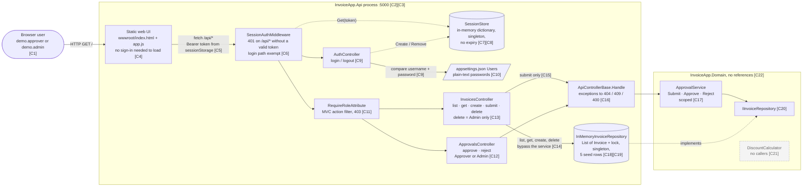
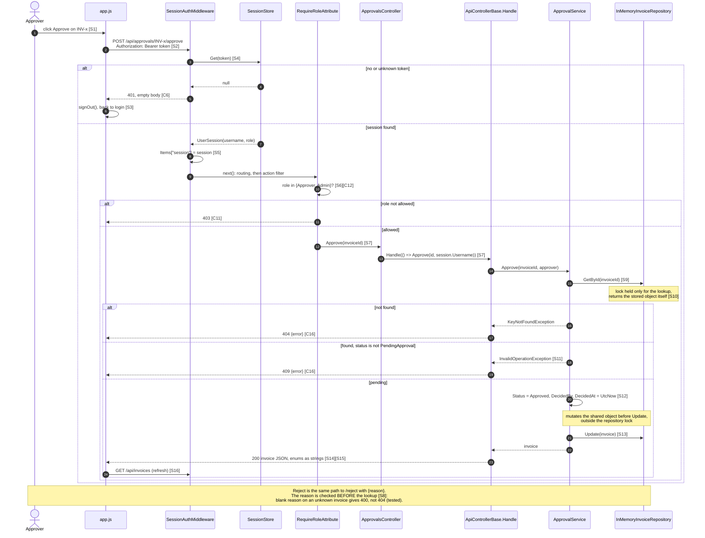

# As-built architecture: Invoice Approval app

What the code in this repository does today, as of 2026-10-29. Every element in
both diagrams carries a citation ID (`[C..]` or `[S..]`) that resolves to a file
and line range in the [citation list](#citations). Anything that could not be
pinned to a line is in [Inferred items](#inferred-items) instead.

Out of scope by design: everything under `ops/` and the assignment brief
(Azure App Service, Azure SQL, Service Bus, PayEx, three instances). None of it
exists in the code; see [Corrections](#corrections) and
[target-state.md](target-state.md).

Citations are checked mechanically:

```bash
python3 -I docs/architecture/check_citations.py docs/architecture/as-built.md docs/architecture/target-state.md
```

## Container view



Rendered through the Mermaid MCP (`validate_and_render_mermaid_diagram`):
[open in Mermaid](https://l.mermaid.ai/hh6Vlb) ·
[PNG](rendered/as-built-container.png)

The outer box is one ASP.NET Core process on `http://localhost:5000` [C2],
with the request pipeline in the order static files, session middleware,
controllers [C3]. The Domain project has no package or project references
[C22]; [the architecture test](#architecture-test) keeps it that way.

What the view shows that the conventions file does not: two of the three
controllers do not consistently go through `ApprovalService`.
`InvoicesController` reads, creates and deletes through the repository
directly [C14], and `AuthController` does not inherit `ApiControllerBase` [C9].

## Approval path: sequence

Approve, with the reject variant and every failure exit the code can take.



Rendered through the Mermaid MCP:
[open in Mermaid](https://l.mermaid.ai/69Uszq) ·
[PNG](rendered/as-built-approval-sequence.png)

## Architecture test

**Rule:** `InvoiceApp.Domain` depends on nothing but the .NET base class
library. Web, storage, messaging and PayEx code go in `InvoiceApp.Api`, behind
interfaces declared in Domain, the way `IInvoiceRepository` [C20] already is.

**Why this rule:** it is true today [C22], and it is the one most likely to
break first. Azure SQL, Service Bus and PayEx all arrive in January, and the
quickest place to put an `HttpClient` or a `DbContext` is next to the business
rule that needs it.

**Test:** [`backend/tests/InvoiceApp.Tests/Architecture/DomainDependencyTests.cs`](../../backend/tests/InvoiceApp.Tests/Architecture/DomainDependencyTests.cs)

```bash
dotnet test backend/InvoiceApp.sln --filter "Category=Architecture"
```

It also runs in CI with every other test, through the `dotnet test` step in
`.github/workflows/ci.yml`.

The rule is enforced three ways. Each earlier version had a gap that was
measured, not guessed:

1. `DomainAssembly_ReferencesOnlyTheBaseClassLibrary`: the compiled Domain
   assembly references only `System.*`, excluding `System.Net*`,
   `System.Data*` and `System.Web*`.
2. `DomainProject_DeclaresNoPackageProjectOrFrameworkReferences`:
   - The SDK is plain `Microsoft.NET.Sdk`.
   - The Domain `.csproj` has no `Import` or `Sdk` element.
   - Neither the `.csproj` nor any inherited `Directory.Build.props`,
     `Directory.Build.targets` or `Directory.Packages.props` declares a
     `PackageReference`, `ProjectReference`, `FrameworkReference`,
     `Reference` or `GlobalPackageReference`.
3. `DomainRestore_ResolvedNoPackagesProjectsOrExtraFrameworks`: Domain's
   `obj/project.assets.json` has no packages, no project references, and no
   framework other than `Microsoft.NETCore.App`. This is what restore
   actually resolved, however the reference was declared.

**Evidence it can fail.** Each violation was seeded in a scratch copy of the
repo, not in this tree:

| Seeded violation | Check 1 only (first version) | Checks 1 + 2 (second version) | Checks 1 + 2 + 3 (current) |
| --- | --- | --- | --- |
| None (the real code) | pass | pass, 2 of 2 | pass, 3 of 3 |
| a. Domain class calls PayEx through `HttpClient` | **fail**: `System.Net.Http` | **fail** | **fail** (check 1) |
| b. Domain uses ASP.NET Core `StatusCodes.Status409Conflict` | **pass: missed it.** The value is a `const`, which the compiler inlines, so no assembly reference is emitted | **fail**: `FrameworkReference Microsoft.AspNetCore.App` | **fail** (checks 2 and 3) |
| b2. Domain takes an ASP.NET Core `HttpContext` parameter | **fail**: `Microsoft.AspNetCore.Http.Abstractions` | **fail** | not re-run |
| c. ASP.NET Core referenced in the `.csproj` but never used | **pass: missed it** | **fail** | **fail** (checks 2 and 3) |
| d. Domain `.csproj` switched to `Sdk="Microsoft.NET.Sdk.Web"` | pass: missed it | **pass: missed it** | **fail** (checks 2 and 3) |
| e. `<Reference Include="Some.Integration">` with a `HintPath` | pass: missed it | **pass: missed it** | **fail** (check 2) |
| f. `backend/Directory.Build.props` adds ASP.NET Core to Domain only | pass: missed it | **pass: missed it** | **fail** (checks 2 and 3) |

Gaps d, e and f were found by the review eval in Task 4. When reviewers were
given this test as a clean case, several said it had no functional defect but
listed these three ways to get past it. Each was then seeded and confirmed
against the second version before the test was changed.

**Known blind spots, still open:**

- File and console I/O through `System.IO` is allowed, because Domain
  legitimately needs other `System.IO` types.
- Reflection or `Type.GetType("...")` can reach any assembly at run time.
- The rule says nothing about the Api project; for example, `InvoicesController`
  calling the repository directly [C14] is not caught.
- A `Reference` or import added through an MSBuild file that is not one of
  the three inherited ones is not scanned by check 2. Check 3 catches it only
  if restore resolves it.
- Check 3 reads `obj/project.assets.json`. If restore output is moved
  elsewhere, the test fails and asks for a build; it does not pass silently.

**Naming:** `AGENTS.md` asks for `<ClassUnderTest>Tests`. This test covers an
assembly rather than a class, so it is named after the rule and kept in its
own `Architecture/` folder.

## Citations

Paths are relative to the repository root. "Must contain" is the text the
checker looks for inside that line range.

| ID | Element | File | Lines | Must contain |
| --- | --- | --- | --- | --- |
| C1 | Two demo users with roles, from config | `backend/src/InvoiceApp.Api/appsettings.json` | 9-12 | `"Role": "Approver"` |
| C2 | Single process on http://localhost:5000 | `backend/src/InvoiceApp.Api/Properties/launchSettings.json` | 6 | `http://localhost:5000` |
| C3 | Pipeline order: default files, static files, session middleware, controllers | `backend/src/InvoiceApp.Api/Program.cs` | 19-22 | `app.UseMiddleware<SessionAuthMiddleware>();` |
| C4 | Static UI served by `UseStaticFiles`, before the auth middleware | `backend/src/InvoiceApp.Api/Program.cs` | 20-21 | `app.UseStaticFiles();` |
| C5 | UI keeps the token in `sessionStorage` and sends it as a bearer header | `backend/src/InvoiceApp.Api/wwwroot/app.js` | 16-19 | `Authorization = \`Bearer` |
| C6 | Middleware: every `/api` path except login needs a session, else 401 | `backend/src/InvoiceApp.Api/Auth/SessionAuthMiddleware.cs` | 19-31 | `Status401Unauthorized` |
| C7 | Sessions held in an in-memory dictionary | `backend/src/InvoiceApp.Api/Auth/SessionStore.cs` | 9 | `ConcurrentDictionary<string, UserSession>` |
| C8 | SessionStore registered as a singleton | `backend/src/InvoiceApp.Api/Program.cs` | 13 | `AddSingleton<SessionStore>()` |
| C9 | AuthController: plain string compare of password; inherits `ControllerBase` | `backend/src/InvoiceApp.Api/Controllers/AuthController.cs` | 9-27 | `u.Password == request.Password` |
| C10 | Users bound from configuration root | `backend/src/InvoiceApp.Api/Program.cs` | 12 | `Configure<DemoUsersOptions>(builder.Configuration)` |
| C11 | Role filter returns 403 | `backend/src/InvoiceApp.Api/Auth/RequireRoleAttribute.cs` | 21-23 | `Status403Forbidden` |
| C12 | Approvals restricted to Approver or Admin | `backend/src/InvoiceApp.Api/Controllers/ApprovalsController.cs` | 9 | `[RequireRole("Approver", "Admin")]` |
| C13 | Delete restricted to Admin | `backend/src/InvoiceApp.Api/Controllers/InvoicesController.cs` | 72-73 | `[RequireRole("Admin")]` |
| C14 | InvoicesController calls the repository directly | `backend/src/InvoiceApp.Api/Controllers/InvoicesController.cs` | 60-75 | `_repository.Remove(id)` |
| C15 | Submit is the only invoice action that goes through the service | `backend/src/InvoiceApp.Api/Controllers/InvoicesController.cs` | 70 | `Handle(() => _approvals.Submit(id))` |
| C16 | Exception to status mapping | `backend/src/InvoiceApp.Api/Controllers/ApiControllerBase.cs` | 15-26 | `return Conflict(` |
| C17 | ApprovalService registered as scoped | `backend/src/InvoiceApp.Api/Program.cs` | 15 | `AddScoped<ApprovalService>()` |
| C18 | Repository registered as a singleton | `backend/src/InvoiceApp.Api/Program.cs` | 14 | `AddSingleton<IInvoiceRepository, InMemoryInvoiceRepository>()` |
| C19 | In-memory list guarded by a lock, seeded | `backend/src/InvoiceApp.Api/InMemoryInvoiceRepository.cs` | 8-17 | `private readonly List<Invoice> _invoices` |
| C20 | Repository interface lives in Domain | `backend/src/InvoiceApp.Domain/IInvoiceRepository.cs` | 3 | `public interface IInvoiceRepository` |
| C21 | DiscountCalculator exists (no callers; see I11) | `backend/src/InvoiceApp.Domain/DiscountCalculator.cs` | 4 | `public class DiscountCalculator` |
| C22 | Domain project file has no references | `backend/src/InvoiceApp.Domain/InvoiceApp.Domain.csproj` | 1-7 | `<TargetFramework>net8.0</TargetFramework>` |
| S1 | Approve button calls `decide` | `backend/src/InvoiceApp.Api/wwwroot/app.js` | 72 | `decide(\`/approvals/${invoice.id}/approve\`` |
| S2 | `decide` POSTs, then refreshes | `backend/src/InvoiceApp.Api/wwwroot/app.js` | 82-86 | `await refresh();` |
| S3 | A 401 signs the user out | `backend/src/InvoiceApp.Api/wwwroot/app.js` | 20 | `response.status === 401 && session` |
| S4 | Middleware looks the token up | `backend/src/InvoiceApp.Api/Auth/SessionAuthMiddleware.cs` | 23-25 | `_sessions.Get(token)` |
| S5 | Session stored on the request | `backend/src/InvoiceApp.Api/Auth/SessionAuthMiddleware.cs` | 33 | `context.Items[HttpContextExtensions.SessionKey] = session` |
| S6 | Role filter reads the session from the request | `backend/src/InvoiceApp.Api/Auth/RequireRoleAttribute.cs` | 19-21 | `!_roles.Contains(session.Role)` |
| S7 | Controller passes the signed-in username to the service via `Handle` | `backend/src/InvoiceApp.Api/Controllers/ApprovalsController.cs` | 22-23 | `_approvals.Approve(invoiceId, HttpContext.GetSession().Username)` |
| S8 | Reject checks the reason before finding the invoice | `backend/src/InvoiceApp.Domain/ApprovalService.cs` | 43-50 | `string.IsNullOrWhiteSpace(reason)` |
| S9 | Find throws when missing | `backend/src/InvoiceApp.Domain/ApprovalService.cs` | 61-63 | `KeyNotFoundException` |
| S10 | GetById returns the stored object under a short lock | `backend/src/InvoiceApp.Api/InMemoryInvoiceRepository.cs` | 25-28 | `lock (_lock) return _invoices.FirstOrDefault` |
| S11 | Only pending invoices can be decided | `backend/src/InvoiceApp.Domain/ApprovalService.cs` | 65-71 | `only pending invoices can be decided` |
| S12 | Approve sets status, approver and time | `backend/src/InvoiceApp.Domain/ApprovalService.cs` | 36-38 | `invoice.DecidedBy = approver;` |
| S13 | Update swaps the list entry | `backend/src/InvoiceApp.Api/InMemoryInvoiceRepository.cs` | 50-56 | `_invoices[index] = invoice` |
| S14 | Success returns 200 with the invoice | `backend/src/InvoiceApp.Api/Controllers/ApiControllerBase.cs` | 13 | `return Ok(action());` |
| S15 | Enums serialised as strings | `backend/src/InvoiceApp.Api/Program.cs` | 10 | `JsonStringEnumConverter` |
| S16 | Refresh re-reads every invoice | `backend/src/InvoiceApp.Api/wwwroot/app.js` | 40-43 | `await api('/invoices')` |

## Inferred items

Each of these is a conclusion drawn from the code, not a line in it. The
**Basis** column says how far it was checked.

| ID | Inferred | Basis |
| --- | --- | --- |
| I1 | The app can only run as one instance. Sessions [C7] and invoices [C19] live in process memory, so a second instance would reject the first one's tokens and show different invoices. | Reading. No deployment config exists in the repo. |
| I2 | All invoices and sessions are lost on restart. | Reading [C19]. |
| I3 | Sessions never expire; a token is valid until logout or restart. | Absence: `SessionStore` has no expiry [C7]. Logout then reuse was tested: 204, then 401. |
| I4 | Two simultaneous approvals of one invoice could both succeed: the pending check [S11] and the update [S12] run outside the repository lock [S10]. | **Not reproduced.** 30 rounds of 8 concurrent approve requests against the running app: 0 rounds with more than one 200. The window is real in the code but too small to hit in memory. With a database and several instances it becomes a lost-update problem. |
| I5 | `Update` is effectively a no-op in memory: `GetById` returns the stored object, so the service has already changed it before `Update` runs [S10][S12][S13]. A real database repository will behave differently, and tests on `FakeInvoiceRepository` will not show it. | Reading. |
| I6 | There is no audit trail. An invoice holds only the last decision (`DecidedBy`, `DecidedAt`, `DecisionNote`), and Delete removes the row entirely [C14]. | Reading `Invoice.cs` and [C14]. |
| I7 | Separation of duties is not enforced: the user who creates and submits an invoice can approve it. There is no `CreatedBy` field. | **Tested:** `demo.approver` created, submitted and approved INV-1037; the approval returned 200. |
| I8 | No HTTPS: the only URL is `http://` [C2] and there is no `UseHttpsRedirection` in [C3]. | Reading. |
| I9 | The app makes no outbound calls and writes no application logs. | `grep` for `HttpClient`, `DbContext`, `SqlConnection`, `ServiceBus`, `PayEx`, `ILogger`: no matches in `backend/src`. |
| I10 | Business validation sits in a controller: `Create` checks the customer name and `Amount > 0` itself (`InvoicesController.cs` lines 50-58), against the AGENTS.md rule. | Reading. |
| I11 | `DiscountCalculator` is dead code [C21], and `IInvoiceRepository.GetByIds` is implemented but never called. | `grep`: no callers outside their own files and the test fake. |
| I12 | The browser actor is a person using the bundled UI. The API accepts any HTTP client with a token; nothing restricts it to the UI. | Reading [C6]. |

## Corrections

What was wrong or misleading in earlier drafts, and in the documents an agent
would naturally trust, found while checking against the code.

| # | What was claimed | Where it came from | What the code shows |
| --- | --- | --- | --- |
| 1 | The approve race "lets two approvals both succeed" (stated as fact in my first summary of this repo) | Agent, from reading `ApprovalService` | Not reproduced in 30 × 8 concurrent attempts. Moved to Inferred (I4) with the evidence. |
| 2 | "Controllers inherit `ApiControllerBase` and use `Handle(...)`" | `AGENTS.md` | `AuthController` inherits `ControllerBase` [C9]; four of five `InvoicesController` actions do not use `Handle` [C14]. |
| 3 | "Business rules go in the Domain project, never in controllers" | `AGENTS.md` | Invoice creation rules are in `InvoicesController.Create` (I10). |
| 4 | "Every endpoint is behind sign-in" | `AGENTS.md` | True for `/api/*` except login [C6]. The UI files are public [C4]; harmless, but the statement is wider than the code. |
| 5 | Azure App Service, Azure SQL, Service Bus, PayEx | Assignment brief, `ops/` | None appear in `backend/src` (I9). Excluded from the as-built view and drawn in [target-state.md](target-state.md). |
| 6 | "Three instances behind a load balancer" | `ops/incidents/INC-2041/README.md` | Impossible as built (I1). |
| 7 | "Open http://localhost:5000" | `README.md`, `AGENTS.md` | On macOS, port 5000 is held by AirPlay Receiver (`ControlCenter`); the app was run on 5050 instead. |
| 8 | The first sequence diagram draft was valid Mermaid | Agent | It was not: a `;` inside a `Note` ends the statement, and mermaid 11.4.1 rejected the diagram at line 32. Replaced with `,`; both diagrams now parse. |
| 9 | Approvals are `POST /api/invoices/{id}/approve`, Approver role only | `ops/incidents/INC-2041/app-logs.txt` line 7, `deploy-diff.patch` | The code routes approvals to `POST /api/approvals/{id}/approve` [S1] and allows Approver **or** Admin [C12]. The ops evidence describes a different, planned version of the code. |
| 10 | T11 pointed at lines 79-81 of the deploy diff | Agent, in the first target-state draft | The call is on line 86; the checker failed the row. Fixed to 84-86. |
| 11 | The second version of the architecture test closed the rule's gaps, and its blind-spot list was complete | Agent, after seeding violations a to c | The Task 4 review eval found three more ways round it: a Web SDK switch, `<Reference>` items, and `Directory.Build.props`. All three were seeded and confirmed to pass the old test. A third check on restore output was added, and the scan now covers inherited build files. |
