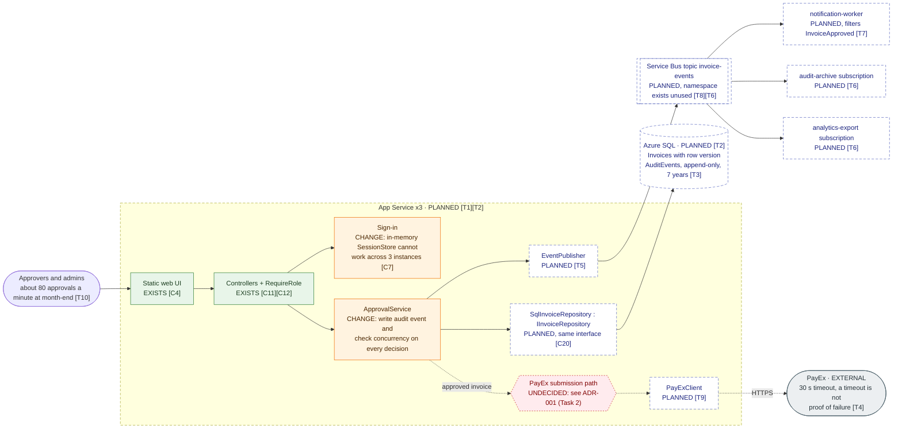

# Target state: Invoice Approval with persistence and PayEx

The service as it needs to look for the January tier-2 launch. It is drawn on
top of the [as-built view](as-built.md), and every box says whether it
**exists**, **changes**, is **planned**, or is **undecided**.

Sources are the assignment brief and the evidence packs under `ops/`. Both
describe a *planned* deployment, so a `[T..]` citation shows where a planned
element came from, not that it exists. Repo-file citations are checked:

```bash
python3 -I docs/architecture/check_citations.py docs/architecture/as-built.md docs/architecture/target-state.md
```

## Container view



Rendered through the Mermaid MCP (`validate_and_render_mermaid_diagram`):
[open in Mermaid](https://l.mermaid.ai/CzdBXD) ·
[PNG](rendered/target-state-container.png)

**Legend:** green = exists today · orange = exists, must change · dashed blue =
does not exist yet · dashed red = not decided yet · grey = external.

There is no target sequence diagram in this file on purpose. The approval
path's sequence depends on how PayEx submission works, which is decided in
[ADR-001](../adr/ADR-001-payex-exactly-once.md). The proposed sequence is
drawn there, next to the reasoning.

## What the target must close

Each gap found in the as-built view, and where the target state deals with it.

| As-built gap | Why it matters in production | Target response | Status |
| --- | --- | --- | --- |
| I1: single instance only, sessions in memory | 3 instances [T1]: a token issued by one instance is unknown to the others, so about 2 in 3 requests would return 401 | Shared session store, or replace demo sign-in with the company identity provider | Choice open |
| I2: data lost on restart | Every deploy wipes all invoices | `SqlInvoiceRepository` behind the existing `IInvoiceRepository` [C20] | Planned |
| I4, I5: check-then-update outside a lock, shared object mutation | With a database and 3 instances, two approvers can both pass the pending check (lost update) | Row version on `Invoices`; the update fails if the row changed since it was read | Planned |
| I6: no audit trail, hard delete | 7-year auditability and SOC 2 [T3] | `AuditEvents` table written in the same transaction as the status change; delete becomes a soft delete or is removed | Planned |
| I7: creator can approve own invoice | SOC 2 reviewers will look for separation of duties | Add `CreatedBy`; `ApprovalService` refuses an approval by the creator | Proposal, not in brief |
| I8: HTTP only | Credentials and tokens in clear text | HTTPS on App Service | Planned |
| none | PayEx must receive each approved invoice exactly once [T4] | ADR-001 (Task 2) | Undecided |

## Planned design in `ops/` that this target does not adopt

The release diff in `ops/incidents/INC-2041/deploy-diff.patch` calls
`_payEx.SubmitAsync(invoice)` inline in `ApprovalsController.Approve`, right
after the approval is saved [T11]. The target leaves that open for three
reasons:

- It puts integration logic in a controller, against `AGENTS.md`.
- It ties the approval request to PayEx's 30-second timeout [T4].
- A timeout after the approval is saved leaves no record of whether PayEx
  received the invoice.

Whether that design caused INC-2041 is not claimed here; that is an incident
question.

## Citations

| ID | Element | File | Lines | Must contain |
| --- | --- | --- | --- | --- |
| T1 | Three instances behind a load balancer | `ops/incidents/INC-2041/README.md` | 32 | `three instances behind a load balancer` |
| T2 | Azure App Service, Azure SQL, GitHub Actions | assignment brief, "Platform" row | n/a | not in repo |
| T3 | Approval actions auditable for seven years; SOC 2 Type II in six months | assignment brief, "Compliance" row | n/a | not in repo |
| T4 | PayEx returns a reference; times out at 30 s; a timeout is not reliable failure | assignment brief, "PayEx behavior" row | n/a | not in repo |
| T5 | EventPublisher component in the approval service | `ops/incidents/INC-2047/publisher-logs.txt` | 2 | `Component: EventPublisher` |
| T6 | Topic `invoice-events` with three subscriptions | `ops/incidents/INC-2047/servicebus-status.txt` | 15-17 | `audit-archive` |
| T7 | notification-worker subscription filters on `InvoiceApproved` | `ops/incidents/INC-2047/servicebus-status.txt` | 19-26 | `"eventType": "InvoiceApproved"` |
| T8 | Service Bus provisioned and unused | assignment brief, "Available but unused" row | n/a | not in repo |
| T9 | A planned `PayExClient` | `ops/incidents/INC-2041/deploy-diff.patch` | 28 | `public class PayExClient : IPayExClient` |
| T10 | About 40,000 invoices a month, peak near 80 approvals a minute | assignment brief, "Volume" row | n/a | not in repo |
| T11 | Planned inline PayEx call in the controller | `ops/incidents/INC-2041/deploy-diff.patch` | 84-86 | `await _payEx.SubmitAsync(invoice)` |
| C4, C7, C11, C12, C20 | Existing elements | see [as-built citations](as-built.md#citations) | | |
